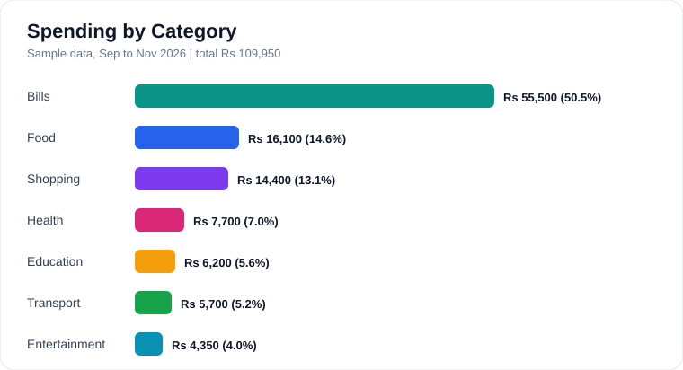
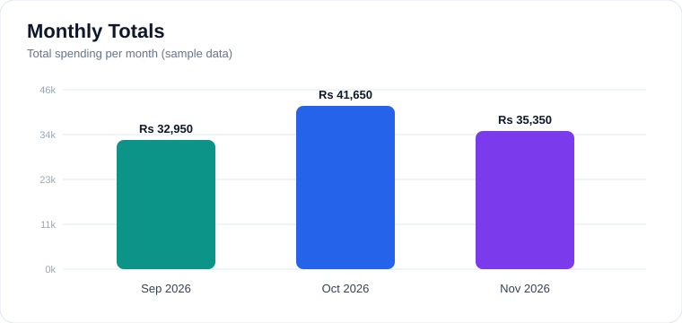
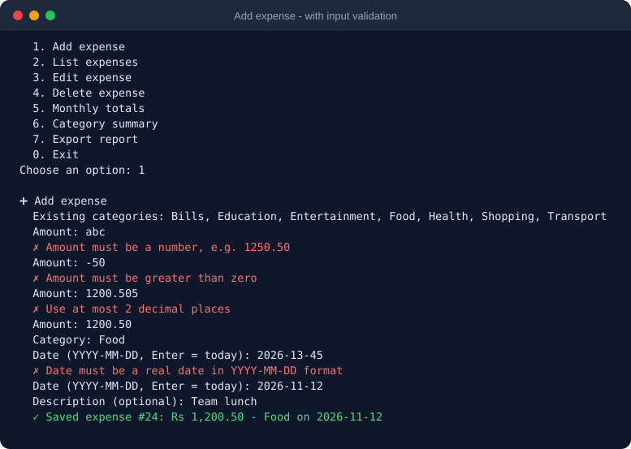
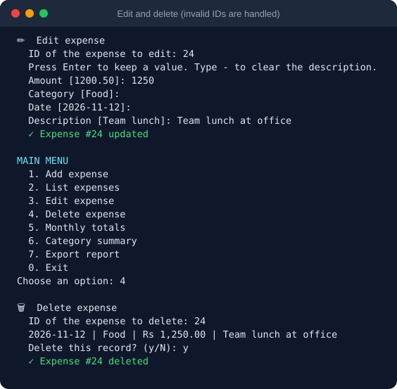
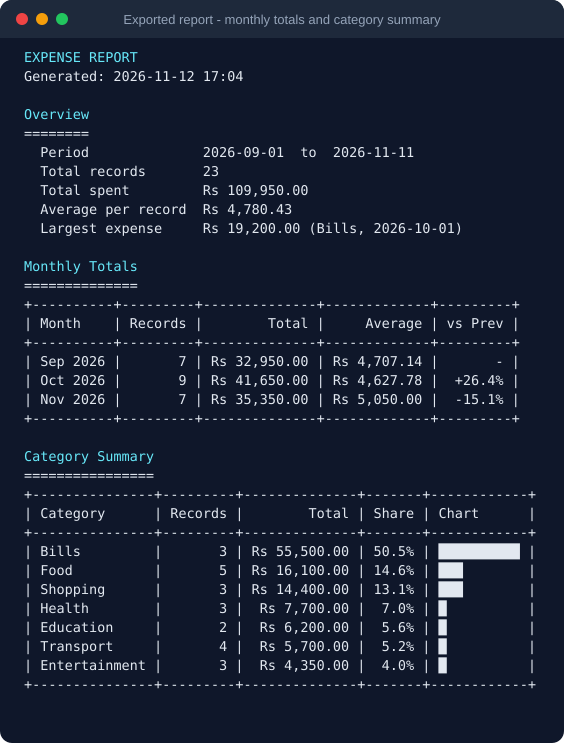
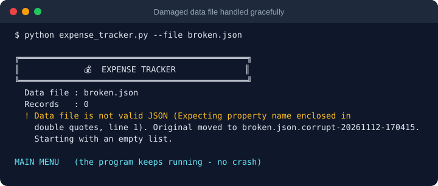

<p align="center">
  
</p>

<p align="center">
  
  
  
  
  
</p>

<h1 align="center"> Expense Tracker</h1>

<p align="center">
  A file-based command-line tool that records, validates and analyses personal or small-business expenses.<br>
  <b>Python Programming - Advanced Level | Task 1</b>
</p>

---

## 📑 Table of Contents
1. [Features](#-features)
2. [Quick Start](#-quick-start)
3. [How to Use](#-how-to-use)
4. [Validation Rules](#-validation-rules)
5. [Data File Format](#-data-file-format)
6. [Reports and Charts](#-reports-and-charts)
7. [Screenshots](#-screenshots)
8. [Project Structure](#-project-structure)
9. [Requirements Checklist](#-requirements-checklist)

---

## ✨ Features

| | Feature | Details |
|---|---|---|
| ➕ | **Add** | Amount, category, date and description with instant validation |
| ✏️ | **Edit** | Press Enter to keep a value; type `-` to clear the description |
| 🗑️ | **Delete** | Asks for confirmation before removing a record |
| 📋 | **List** | Sorted table, optional filter by month (`YYYY-MM`) |
| 📅 | **Monthly totals** | Records, total, average and change versus previous month |
| 📊 | **Category summary** | Total, share (%) and a text bar chart per category |
| 📤 | **Export report** | `.txt`, `.md` (Markdown) or `.csv` |
| 🛡️ | **Safe storage** | Atomic saves, automatic backup of damaged files, no crashes |

---

## 🚀 Quick Start

No extra libraries are needed. Only the Python standard library is used.

```bash
# 1. Run with a fresh data file (created automatically)
python expense_tracker.py

# 2. Try it with the included sample data (23 records)
python expense_tracker.py --file sample_data/expenses_sample.json

# 3. Optional settings
python expense_tracker.py --file my_expenses.json --currency "$"
```

| Option | Default | Meaning |
|---|---|---|
| `--file` | `expenses.json` | JSON file used to save and load data |
| `--currency` | `Rs` | Currency label shown in tables and reports |

---

## 🧭 How to Use

```
MAIN MENU
  1. Add expense
  2. List expenses
  3. Edit expense
  4. Delete expense
  5. Monthly totals
  6. Category summary
  7. Export report
  0. Exit
```

Every change is saved to the JSON file immediately, so nothing is lost if the program closes.

**Exporting a report:** choose option `7` and type a file name. The extension decides the format:

| Extension | Output |
|---|---|
| `report.txt` | Plain-text report (overview, monthly, category, all records) |
| `report.md` | Same report as Markdown tables |
| `report.csv` | Raw records for Excel or Google Sheets |

---

## ✅ Validation Rules

| Field | Rule | Example of rejected input |
|---|---|---|
| Amount | Number, greater than 0, max 2 decimals, up to 10,000,000 | `abc`, `-50`, `1200.505` |
| Date | Real calendar date as `YYYY-MM-DD`, year 2000 or later (Enter = today) | `2026-13-45` |
| Category | Not empty, up to 30 characters (auto-capitalised) | empty text |
| Description | Optional, up to 100 characters | text longer than 100 characters |
| ID | Whole number that exists in the data | `99` when it does not exist |

**Damaged or missing data files**

| Situation | What the program does |
|---|---|
| File does not exist | Starts empty and creates it on the first save |
| File is empty | Starts empty |
| File is not valid JSON | Renames it to `*.corrupt-<time>` and starts empty |
| Some records are broken | Skips only those records, keeps a `.bak` copy of the original |
| Duplicate IDs | Duplicate record is skipped and reported |

---

## 🗂️ Data File Format

```json
{
  "version": 1,
  "expenses": [
    {
      "id": 1,
      "amount": 18500.0,
      "category": "Bills",
      "date": "2026-09-01",
      "description": "Electricity bill"
    }
  ]
}
```

---

## 📈 Reports and Charts

Charts below are drawn from the included sample data (`sample_data/expenses_sample.json`).

<p align="center"></p>
<p align="center"></p>

**Sample monthly totals (from the exported report)**

| Month | Records | Total | Average | vs Prev |
|:---|---:|---:|---:|---:|
| Sep 2026 | 7 | Rs 32,950.00 | Rs 4,707.14 | - |
| Oct 2026 | 9 | Rs 41,650.00 | Rs 4,627.78 | +26.4% |
| Nov 2026 | 7 | Rs 35,350.00 | Rs 5,050.00 | -15.1% |

**Sample category summary**

| Category | Records | Total | Share |
|:---|---:|---:|---:|
| Bills | 3 | Rs 55,500.00 | 50.5% |
| Food | 5 | Rs 16,100.00 | 14.6% |
| Shopping | 3 | Rs 14,400.00 | 13.1% |
| Health | 3 | Rs 7,700.00 | 7.0% |
| Education | 2 | Rs 6,200.00 | 5.6% |
| Transport | 4 | Rs 5,700.00 | 5.2% |
| Entertainment | 3 | Rs 4,350.00 | 4.0% |

Full exports: [`report.txt`](sample_output/report.txt), [`report.md`](sample_output/report.md), [`report.csv`](sample_output/report.csv).
A complete terminal session is saved in [`demo_session.txt`](sample_output/demo_session.txt).

---

## 🖼️ Screenshots

**Adding an expense (invalid inputs are rejected with clear messages)**



**Editing and deleting (including an invalid ID)**



**Exported report**



**Damaged data file handled gracefully**



---

## 📁 Project Structure

```
Task1_Expense_Tracker/
├── expense_tracker.py          # main program
├── README.md
├── assets/                     # banner, icon, charts, screenshots
├── sample_data/
│   └── expenses_sample.json    # 23 example records
└── sample_output/
    ├── report.txt
    ├── report.md
    ├── report.csv
    └── demo_session.txt        # full interactive session
```

**Code design**

| Part | Role |
|---|---|
| `parse_*` functions | Validate and clean every input |
| `Expense` (dataclass) | One record, with `from_dict` validation |
| `ExpenseStore` | Load, save (atomic), add, update, delete |
| `monthly_totals`, `category_summary`, `build_report` | Analysis and report text |
| `ui_*` functions and `main` | Menu and user interaction |

---

## 🎯 Requirements Checklist

| Requirement | Status | Where |
|---|:---:|---|
| Add, edit, delete and list records | ✅ | Menu options 1 to 4 |
| Amount, category, date, description | ✅ | `Expense` dataclass |
| Save to JSON and load at start | ✅ | `ExpenseStore.save` / `load` |
| Validate amounts and dates | ✅ | `parse_amount`, `parse_date` |
| Handle missing or damaged files | ✅ | `ExpenseStore.load`, `_quarantine` |
| Monthly totals and category summaries | ✅ | Options 5 and 6 |
| Export a report | ✅ | Option 7 (`.txt`, `.md`, `.csv`) |
| Source code, README, sample output | ✅ | This folder |

---

<p align="center">Made with Python 🐍 | Domain 3 - Task 1</p>
